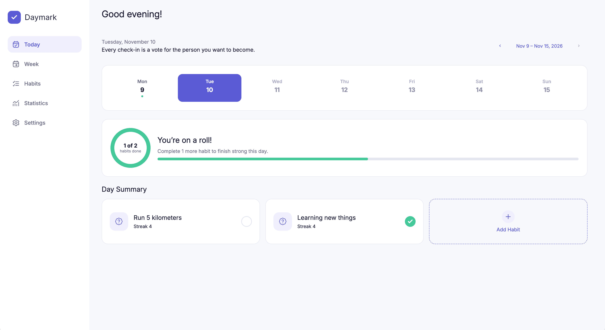
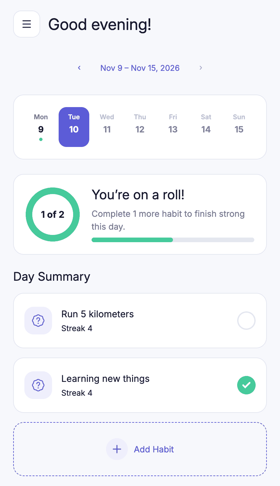

# Habit Tracker

Трекер привычек, который я делаю сам: фронтенд на React и REST API на Node.js в одном pnpm-монорепозитории. Возможно, в дальнейшем появятся другие Frontend-фреймворки.

<p align="center">
  <picture>
    <source media="(prefers-color-scheme: dark)" srcset="docs/desktop-dark.png" />
    
  </picture>
  <picture>
    <source media="(prefers-color-scheme: dark)" srcset="docs/mobile-dark.png" />
    
  </picture>
</p>

## Зачем этот репозиторий

- **Показать, как я работаю:** Я фронтенд-разработчик (в продакшене Vue 3 с его богатой экосистемой + TypeScript). Коммерческий код закрыт NDA, а здесь можно посмотреть на мой код, решения и то, как я организую проект.
- **Изучать новое:** На этом проекте я осваиваю то, с чем не могу работать на основной работе: React, TanStack Query (его React-версия, Vue-версия активно применяется в работе), React Router, Fastify, Drizzle, PostgreSQL, Docker.
- **Найти следующую работу:** Если вы нанимаете, здесь видно, что я умею.
- **Честно про ИИ:** Код пишу я сам. ИИ-ассистент работает как консультант и ревьюер: объясняет концепции, находит ошибки, предлагает варианты. Решения и реализация — мои. Цель проекта это прокачаться самому.

## Что внутри

| Путь       | Что                                                                 |
| ---------- | ------------------------------------------------------------------- |
| `apps/web` | React 19 + React Compiler, TypeScript, Vite, TanStack Query, React Router, Zod, Feature-Sliced Design, CSS Modules + SCSS |
| `apps/api` | Node.js, Fastify, Drizzle ORM, PostgreSQL, Docker, Vitest          |

На что стоит посмотреть во фронтенде: оптимистичные обновления с откатом, типизированная обработка ошибок от HTTP-слоя до интерфейса, валидация форм на общих с доменом схемах, доступные модалки на нативном `<dialog>`.

**Инструменты и инфраструктура**

- pnpm workspaces — один `install` и общие скрипты для обоих приложений
- TypeScript 7 (нативный компилятор) в strict-режиме. (`.pnpmfile.cjs` подменяет зависимость только для плагинов линтера, так как typescript-eslint пока поддерживает только TS 6)
- oxlint + ESLint с type-aware правилами, stylelint, Steiger для архитектуры FSD
- Docker Compose: PostgreSQL, миграции и API одной командой
- Browserslist на Baseline, EditorConfig

## Макет

За основу взят макет [Habit Tracker by Zhiar](https://www.figma.com/community/file/1687845144588569050/habit-tracker-by-zhiar) из Figma Community. Я значительно его переработал: собрал типографику в систему стилей, добавил состояния загрузки, ошибок и пустых списков, которых не было в макете, адаптировал вёрстку под мобильные и планшетные экраны.

## Статус

В разработке. Дальше — статистика и календарь отметок за месяц.

## Запуск

```bash
pnpm install
cd apps/api && pnpm docker:up   # PostgreSQL + API
pnpm dev:web                    # фронтенд на http://localhost:5173
```

## Лицензия

Этот проект распространяется под лицензией **Zero-Clause BSD (0BSD)**. Вы можете свободно копировать, изменять и использовать этот код в любых целях (включая коммерческие) без необходимости указывать мое авторство или сохранять уведомления о копирайте.
